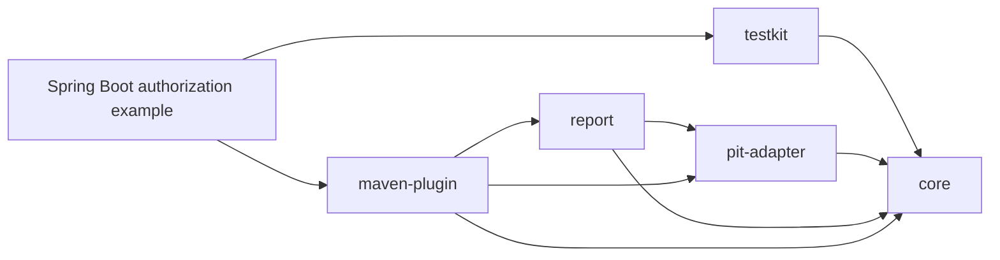

# Module map

This map describes the modules in the published V1.0.0 repository. It separates the five public Maven artifacts from the Spring Boot authorization example, which is a local educational consumer and is not a published CIG artifact.

## Public Maven artifacts

| Maven artifact | Repository path | Responsibility |
| --- | --- | --- |
| `code-integrity-guard-core` | `code-integrity-guard-core/` | Framework-independent contract and evidence types, plus deterministic evaluation. |
| `code-integrity-guard-testkit` | `code-integrity-guard-testkit/` | JUnit invocation evidence and optional Spring MVC authorization scenario helpers. |
| `code-integrity-guard-pit-adapter` | `code-integrity-guard-pit-adapter/` | Reads and evaluates an existing PIT XML report; it does not run PIT or create mutations. |
| `code-integrity-guard-report` | `code-integrity-guard-report/` | Serializes CIG results to JSON and HTML. |
| `code-integrity-guard-maven-plugin` | `code-integrity-guard-maven-plugin/` | Coordinates evidence preparation, sealing, evaluation, reporting, and Maven build gates. |

The module dependencies point inward toward `core`:

Arrows show only inter-module dependencies declared by the current POMs; third-party dependencies are omitted. The `core` module does not depend on Maven, Spring, PIT, or reporting frameworks. The adapters and Maven integration depend toward core; core never depends on adapters.

## Educational example

`examples/spring-boot-authorization/` is a synthetic Spring Boot consumer used to exercise authorization scenarios locally and in CI. It is not one of the five public artifacts and must not be deployed. Its Spring dependencies and test configuration belong to that example, not to `core`.

For the design boundaries and evidence flow, see [Software Design](software-design.md). The accepted [ADR 0001](adr/0001-modules-and-license.md) records the module-boundary decision. This map reflects the current V1.0.0 layout; it does not describe proposed roadmap work as implemented.
